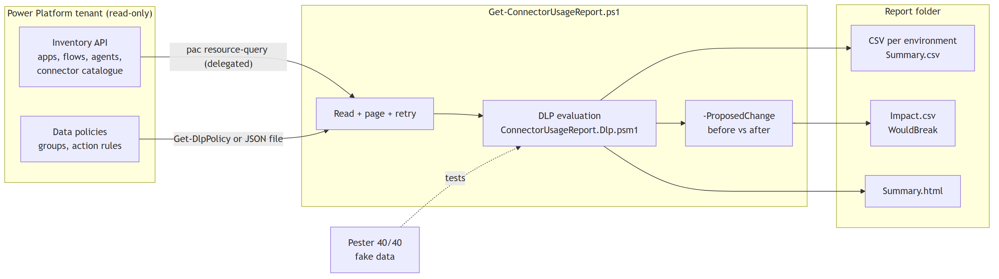

# Power Platform connector usage report

A PowerShell script for Power Platform administrators who want to change a data (DLP) policy without breaking
apps, flows or agents.

For every environment it reports which connectors are used by canvas apps, model-driven apps, cloud flows, agent
flows and Copilot Studio agents, who owns them, and which policy group each connector is in. With a proposed
change ("block connector X", "move X to Business") it lists what would stop working.

The script is **read-only**. It writes report files to a local folder and changes nothing in the tenant.



## What is in this repository

| Folder | Content |
|---|---|
| [scripts/](scripts/) | `Get-ConnectorUsageReport.ps1` (run this), `ConnectorUsageReport.Dlp.psm1` (DLP evaluation logic, keep it next to the script), `tests/` (Pester tests) |
| [docs/RUN-GUIDE.md](docs/RUN-GUIDE.md) | Prerequisites, permissions, install, run, how to read the report, limits, troubleshooting |
| [samples/](samples/) | A complete sample report and [a walkthrough of every file](samples/README.md) |
| [screenshots/](screenshots/) | The HTML summary of the sample run |

## Quick start

```powershell
# 1. Get the files
git clone https://github.com/sayedpfe/powerplatform-connector-usage-report.git
cd powerplatform-connector-usage-report\scripts

# 2. Prerequisites (once)
winget install Microsoft.PowerAppsCLI
Install-Module Microsoft.PowerApps.Administration.PowerShell -Scope CurrentUser
pac auth create          # sign in as a Power Platform administrator of your tenant

# 3. Preview, then run
.\Get-ConnectorUsageReport.ps1 -IncludeFlows -IncludeAgents -WhatIf
.\Get-ConnectorUsageReport.ps1 -IncludeFlows -IncludeAgents

# 4. Test a proposed policy change
.\Get-ConnectorUsageReport.ps1 -IncludeFlows -IncludeAgents -ProposedChange 'shared_sql=Blocked'
```

Open `Summary.html` in the report folder. Details: [docs/RUN-GUIDE.md](docs/RUN-GUIDE.md).

If the script was downloaded as a ZIP, Windows may block it: `Get-ChildItem -Recurse | Unblock-File`.

## What you get

| File | Answers |
|---|---|
| `Summary.html` | The overview for a review meeting |
| `ConnectorUsage_<environment>.csv` | Which app, flow or agent uses which connector, owner, last modified, policy and group |
| `Summary.csv` | Per connector and environment: how many apps, flows, agents and owners |
| `Environments.csv` | Per environment: type, Managed Environment, policies, violations today, would break |
| `DlpPolicies.csv` | Per policy: where each connector sits, action rules, endpoint rules |
| `PolicyGaps.csv` | Connectors in a policy but used nowhere; connectors in use but never classified |
| `Impact.csv` | For a proposed change: what would break, what is already broken, what would be fixed |

See the [sample walkthrough](samples/README.md) for real rows from each file.

## How it works

| Step | Source | Status on Microsoft Learn |
|---|---|---|
| Usage | [Power Platform inventory](https://learn.microsoft.com/en-us/power-platform/admin/power-platform-inventory) through `pac resource-query query-resources` | Inventory API: generally available. The pac command: preview |
| Policies | `Get-DlpPolicy` and `Get-PowerAppDlpPolicyConnectorConfigurations` from `Microsoft.PowerApps.Administration.PowerShell` | Generally available |
| Evaluation | The documented rules: one group per app, flow or agent in every applicable policy; Blocked wins; default group; action rules | [Connector classification](https://learn.microsoft.com/en-us/power-platform/admin/dlp-connector-classification), [combined effect of multiple policies](https://learn.microsoft.com/en-us/power-platform/admin/dlp-combined-effect-multiple-policies) |

## Requirements

| | |
|---|---|
| Role | Power Platform administrator (Global administrator or Dynamics 365 administrator also work) |
| Tools | Power Platform CLI 2.x, Windows PowerShell 5.1 or PowerShell 7, the admin PowerShell module |
| Sign-in | Interactive user sign-in. A service principal is not possible: the inventory API accepts delegated sign-in only |

## Limits

The report lowers the risk of a policy change. It does not prove that nothing breaks.

- Built-in HTTP actions in flows, desktop flows, code apps and endpoints are not in the inventory.
- Endpoint filtering, tenant-level custom connector URL patterns, Copilot Studio channel and authentication rules
  and resource exemptions are not evaluated.
- There is no "last run"; use last modified and flow status.
- Inventory data can be up to 15 minutes old.
- Policy enforcement after a change is asynchronous, usually within an hour and up to 24 hours. Test in a
  non-production environment first.

Full list: [docs/RUN-GUIDE.md](docs/RUN-GUIDE.md#limits).

## Test status

| Tested on 2026-11-17 | Result |
|---|---|
| Pester tests of the DLP logic (fake data) | 40 of 40 pass on PowerShell 7.6 and Windows PowerShell 5.1 |
| Full run against a demo tenant, pac 2.12.2: 17 environments, 608 resources | Same result on both shells, 33 seconds |
| Join to a real data policy (scope, groups, default group, action rule) | Verified against one test policy |
| `-WhatIf`, environment filter, tenant guard | Verified |

Not yet exercised in a live run: the interactive `Add-PowerAppsAccount` path (policies were read from the same
service route and passed with `-DlpPolicyPath`), owner name lookup, and the retry on throttling (no throttling
occurred). Please report problems as an issue.

## Run the tests

```powershell
Install-Module Pester -MinimumVersion 5.5.0 -Scope CurrentUser
Invoke-Pester -Path .\scripts\tests
```

## Disclaimer

This is not an official Microsoft solution and is not supported by Microsoft. The evaluation is an implementation
of the rules documented on Microsoft Learn, not Microsoft's enforcement engine; Microsoft can change the platform
behaviour without notice. Provided as is, without warranty of any kind. See [LICENSE](LICENSE).
