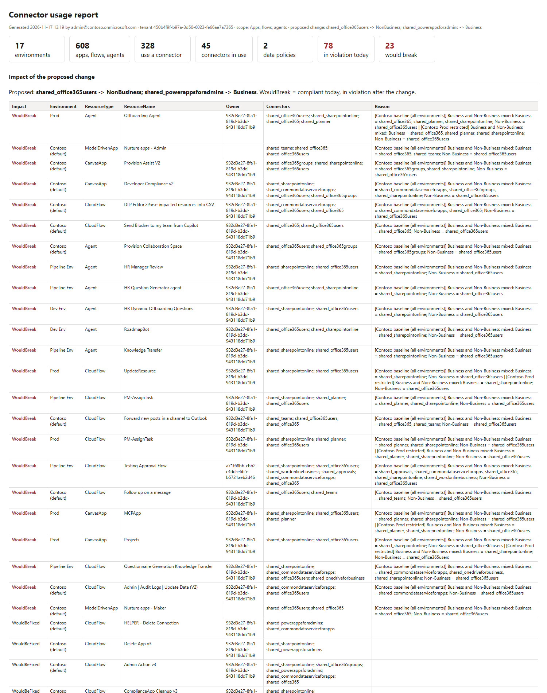

# Sample output: what you will get

The folder [contoso-demo](contoso-demo/) is a complete report from one run of the script. Open
[contoso-demo/Summary.html](contoso-demo/Summary.html) in a browser first, then use this page to read the files.



## Where the sample comes from

| Part | Source |
|---|---|
| Apps, flows, agents, connectors, environments | A real run against a Contoso demo tenant on 2026-11-17. Ids, tenant and account names are replaced; resource names are demo content. |
| Data policies | **A sample policy file**, [contoso-demo/sample-dlp-policies.json](contoso-demo/sample-dlp-policies.json), not the tenant's live policies. It was written to show every part of the report: two policies, a blocked group, an action rule and an endpoint rule. |
| Owner names | Not resolved in this run, so `Owner` shows an object id. In your run it shows the display name and UPN when the admin module is signed in. |

Command that produced it:

```powershell
.\Get-ConnectorUsageReport.ps1 -IncludeFlows -IncludeAgents `
    -DlpPolicyPath .\sample-dlp-policies.json `
    -ProposedChange 'shared_office365users=NonBusiness', 'shared_powerappsforadmins=Business'
```

The two sample policies:

| Policy | Scope | Business | Blocked | Rules |
|---|---|---|---|---|
| Contoso baseline (all environments) | All environments | SharePoint, Outlook, Office 365 Users, Teams, Dataverse, OneDrive for Business, Microsoft 365 Groups, Planner, Excel Online, Approvals, Word Online, SQL Server | X, RSS, Dropbox | MSN Weather: action `TodaysForecast` blocked. SQL Server: endpoint rules |
| Contoso Prod restricted | Only the `Prod` environment | SharePoint, Outlook, Office 365 Users, Teams, Dataverse, Planner, Approvals | Azure DevOps, HTTP with Microsoft Entra ID | none |

Everything else is in the default group, Non-Business.

## The numbers of this run

| | |
|---|---|
| Environments | 17 |
| Apps, flows and agents read | 608 |
| Connectors in use | 45 |
| Data policies | 2 |
| In violation today | 78 |
| Would break with the proposed change | 23 |
| Use at least one connector | 328 |
| Run time | 33 seconds |

## The files, one by one

### Summary.html
The page to open first and to show in a review meeting. Top to bottom: totals, the impact of the proposed change,
the connectors in use across the tenant, the environments, the policy gaps, and the limits to keep in mind.
Red = would break or in violation.

### ConnectorUsage_<environment>.csv
One file per environment that has connector usage (9 files here). **One row per connector per app, flow or agent.**
This is the detail you filter in Excel.

From `ConnectorUsage_Prod.csv`:

| Connector | ResourceType | ResourceName | LastModified | DlpPolicy | DlpGroup | DlpStatus |
|---|---|---|---|---|---|---|
| shared_sharepointonline | CanvasApp | Projects | 2026-10-08T07:41:55Z | Contoso baseline (all environments); Contoso Prod restricted | Business; Business | Compliant |
| shared_office365users | CanvasApp | Projects | 2026-10-08T07:41:55Z | Contoso baseline (all environments); Contoso Prod restricted | Business; Business | Compliant |
| shared_planner | CloudFlow | PM-AssignTask | 2026-06-23T12:01:22Z | same two policies | Business; Business | Compliant |

How to read it: the app `Projects` uses two connectors. Two policies cover `Prod`. `DlpGroup` gives the group in
each policy, in the same order as `DlpPolicy`. Both connectors are Business in both policies, so the app is
compliant.

A row in violation carries the reason in `DlpViolation`, for example:

```
[Contoso Prod restricted] Business and Non-Business mixed:
Business = shared_commondataserviceforapps, shared_sharepointonline; Non-Business = shared_wordonlinebusiness
```

Word Online is Business in the baseline but not named in the Prod policy, so there it falls into the default group
and no longer matches SharePoint and Dataverse. This is the typical way a second policy breaks a flow.

Other columns: `ConnectorName`, `Tier` (Standard, Premium, Custom), `Publisher`, `ConnectorRole` (Action, Trigger),
`Operations` (the actions used, where the inventory reports them), `ResourceStatus` (Activated, Deactivated,
Suspended for flows), `Owner`, `OwnerId`, `EnvironmentType`, `ManagedEnvironment`, `ResourceId`, `EnvironmentId`.

### Summary.csv
Connector by environment, with counts. Use it to answer "how much is this connector used, and where".

From the `Prod` rows:

| Connector | ConnectorName | Tier | CanvasApps | ModelDrivenApps | CloudFlows | AgentFlows | Agents | TotalResources | Owners |
|---|---|---|---|---|---|---|---|---|---|
| shared_sharepointonline | SharePoint | Standard | 6 | 1 | 21 | 4 | 2 | 34 | 2 |
| shared_commondataserviceforapps | Microsoft Dataverse | Premium | 1 | 1 | 17 | 0 | 1 | 20 | 3 |
| shared_office365users | Office 365 Users | Standard | 3 | 1 | 3 | 0 | 2 | 9 | 2 |
| shared_office365 | Office 365 Outlook | Standard | 0 | 1 | 0 | 0 | 6 | 7 | 2 |

`Owners` is the number of different owners, `LastModified` the most recent change among those resources.

### Environments.csv
One row per environment in scope.

| Environment | EnvironmentType | ManagedEnvironment | DlpPolicies | Resources | WithConnectors | DistinctConnectors | CurrentViolations | WouldBreak |
|---|---|---|---|---|---|---|---|---|
| Contoso (default) | Default | False | Contoso baseline (all environments) | 268 | 162 | 33 | 59 | 10 |
| Prod | Production | True | Contoso baseline (all environments); Contoso Prod restricted | 113 | 65 | 17 | 10 | 5 |
| Pipeline Env | Developer | True | Contoso baseline (all environments) | 53 | 36 | 15 | 7 | 6 |

Use it to see where the risk sits. Here the default environment carries most violations, which is common.

### DlpPolicies.csv
One row per connector that a policy names, plus connectors that only carry rules. Shows scope, default group,
group, action rules and whether endpoint rules exist, and how many resources in the covered environments use it.

| Policy | Connector | Group | ActionRules | EndpointRules |
|---|---|---|---|---|
| Contoso baseline (all environments) | shared_msnweather | NonBusiness | default=Allow; todaysforecast=Block | |
| Contoso baseline (all environments) | shared_sql | Business | | Yes (not evaluated) |

Action rules are evaluated against the operations a resource uses. Endpoint rules are only listed: the inventory
does not know which server or URL a resource connects to.

### PolicyGaps.csv
The cleanup list.

| Gap | Meaning | In this sample |
|---|---|---|
| `UsedNotClassified` | The connector is used in an environment the policy covers, but the policy does not name it. It sits in the default group. | 32 for the baseline, 10 for the Prod policy |
| `ClassifiedNotUsed` | The policy names the connector, nothing in scope uses it. | 3 for the baseline (X, Dropbox, SQL Server), 2 for the Prod policy (Approvals, HTTP with Microsoft Entra ID) |

`UsedNotClassified` rows with many resources are the ones to decide on first: they are in use today and their group
was never chosen on purpose. `Ignored (default)` marks a custom connector in a tenant-level policy, which is
governed by URL patterns the script cannot evaluate.

### Impact.csv
Only written with `-ProposedChange`. One row per app, flow or agent that uses a changed connector or changes status.

| Impact | Rows here | Meaning |
|---|---|---|
| `WouldBreak` | 23 | Compliant today, in violation after the change |
| `AlreadyViolating` | 72 | In violation today and after |
| `WouldBeFixed` | 6 | In violation today, compliant after |
| `NoImpact` | 6 | Uses a changed connector, stays compliant |

Three rows from the sample:

| Impact | Environment | ResourceType | ResourceName | Connectors | Reason |
|---|---|---|---|---|---|
| WouldBreak | Contoso (default) | Agent | Provision Collaboration Space | shared_office365users; shared_office365groups | Business and Non-Business mixed: Business = shared_office365groups; Non-Business = shared_office365users |
| WouldBeFixed | Contoso (default) | CloudFlow | Admin Action v3 | shared_sharepointonline; shared_office365groups; shared_powerappsforadmins; shared_commondataserviceforapps; shared_office365 | (compliant after) |
| AlreadyViolating | Maker_Dev_01 | Agent | TEST QA Offboarding | shared_sharepointonline; shared_a365copilotchatmcp | Business and Non-Business mixed: Business = shared_sharepointonline; Non-Business = shared_a365copilotchatmcp |

Reading the first row: moving Office 365 Users to Non-Business separates it from Microsoft 365 Groups, which stays
Business. The agent uses both, so it would stop. The second row shows the opposite: moving Power Apps for Admins to
Business brings that flow's five connectors into one group.

The file also has `Owner`, `LastModified`, `ResourceStatus`, `Before`, `After` and `PolicyAfter`, so you can sort by
owner and contact people before the change.

### run.log
What was read and when: pac account and tenant, proposed changes, pages read, policies read, warnings and retries.
Keep it with the report as evidence of what the run covered.

### sample-dlp-policies.json
The policy file used for this sample, in the format of `Get-DlpPolicy`. You do not need such a file: without
`-DlpPolicyPath` the script reads your real policies. It is here so you can see the format and re-run the sample.

## What will differ in your tenant

| In the sample | In your run |
|---|---|
| Policies come from a sample file | Your real data policies, read with `Get-DlpPolicy` |
| `Owner` is an object id | Display name and UPN |
| 608 resources, 33 seconds | Larger tenants take longer: about 250 resources per request |
| Proposed change chosen to show all four impact values | Your own proposed moves; run once per scenario |

## Limits to keep in mind when you read a report

Built-in HTTP actions, desktop flows, endpoints and resource exemptions are not in the data. See
[the run guide](../docs/RUN-GUIDE.md#limits) for the full list.
